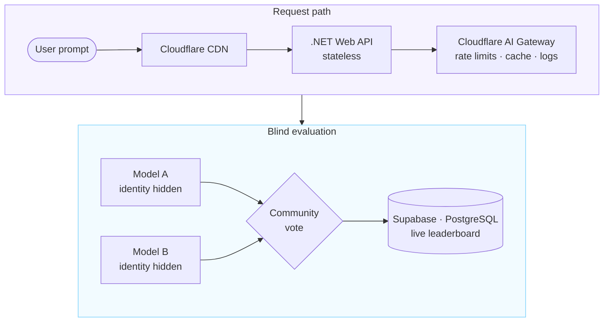
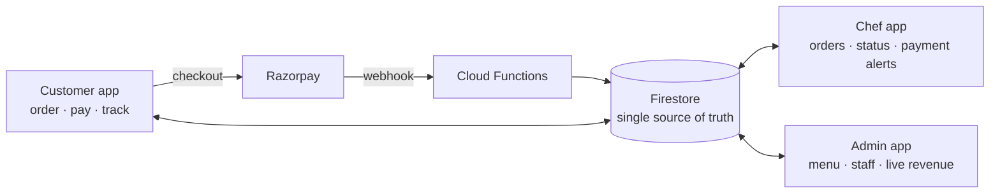
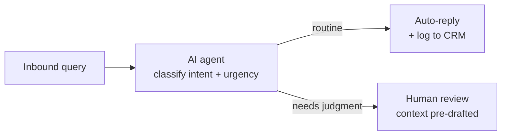

<!-- ══════════════════════════════════════════════════════════════ -->
<!--         HARSH BHANUSHALI  ·  GitHub Profile README           -->
<!--  Stats, language and snake images are generated daily by     -->
<!--  .github/workflows/profile-assets.yml into the `output` branch -->
<!-- ══════════════════════════════════════════════════════════════ -->

  

<picture>
  <source media="(prefers-color-scheme: light)" srcset="https://readme-typing-svg.demolab.com?font=Space+Grotesk&weight=700&size=22&duration=3000&pause=1500&color=7C3AED&center=true&vCenter=true&width=700&lines=I+build+systems.+Real+ones.+Deployed.+Live."/>
  
</picture>

<picture>
  <source media="(prefers-color-scheme: light)" srcset="https://readme-typing-svg.demolab.com?font=JetBrains+Mono&weight=400&size=13&duration=2500&pause=1000&color=0369A1&center=true&vCenter=true&width=800&lines=Flutter+%C2%B7+.NET+Web+API+%C2%B7+Firebase+%C2%B7+Supabase+%C2%B7+Azure+%C2%B7+Cloudflare+CDN+%C2%B7+Cloudflare+AI+Gateway;Peak+traffic+handled.+Real-time+payments+shipped.+Security+systems+built.+SEO+ranking+earned.;Open+to+internships+%C2%B7+freelance+%C2%B7+AI+product+builds+%C2%B7+early-stage+startups."/>
  
</picture>

 

<!-- The view counter stays keyed to the old username so the existing count carries over. -->
&nbsp;
&nbsp;

## ◈ ABOUT

CS student and co-founder of **[DualMind Labs](https://dualmindlab.tech)**. I take products from idea to production — app, API, database, infrastructure, security and docs — and keep them running after launch.

- 🔭 **Building:** [DualMind Arena](https://arena.dualmindlab.tech), a blind head-to-head AI model evaluation platform, now expanding into AI agent evaluation
- 🛠️ **Day to day:** Flutter · .NET Web API · Supabase / Firebase · Azure · Cloudflare CDN + AI Gateway
- 🤝 **Open to:** internships · freelance · AI product builds · early-stage startups
- 🌏 **Based in:** Rajkot, India · IST (UTC+5:30) · async-friendly
- 📫 **Reach me:** [bhanushaliharsh434@gmail.com](mailto:bhanushaliharsh434@gmail.com)

## ◈ PROOF OF WORK

*Real numbers from systems I have shipped.*

| | What shipped |
|:--|:--|
| ⚡&nbsp;**Traffic** | Absorbed a **5,000+ request** spike (bots + real users) Cloudflare CDN took the load before it reached the origin |
| 💳&nbsp;**Payments** | Razorpay payments synced in real time across **3 apps** Webhook → Cloud Function → one Firestore write every app listens to |
| 🔒&nbsp;**Security** | Login anomaly detection, IP capture, risk scoring, owner email alerts Designed into DualMind Arena at launch, not added after an incident |
| 📈&nbsp;**SEO** | **#1 on Google** for "DualMind Labs" [dualmindlab.tech](https://dualmindlab.tech) |
| 📄&nbsp;**Docs** | Full user documentation, written and published [docs.dualmindlab.tech](https://docs.dualmindlab.tech) |
| 🔁&nbsp;**Ownership** | Design → code → infra → deploy → docs End to end, from first commit to a monitored production system |

## ◈ FEATURED PROJECTS

### ⚔️ DualMind Arena — blind AI model evaluation

&nbsp;
&nbsp;

> **Problem:** public AI benchmarks are easy to game. Vendors cherry-pick prompts, brand recognition skews votes, and nobody can audit the results. 
> **Approach:** blind head-to-head battles on real community prompts. Model identities stay hidden until the vote is locked.

- **Cloudflare AI Gateway** routes every LLM call: rate limiting, response caching and per-request observability across all model providers
- **Stateless .NET Web API** behind Cloudflare CDN, so scaling out is a config change, not a rewrite
- **Supabase (PostgreSQL)**, chosen over Firebase on purpose: leaderboard ranking needs relational SQL
- **Real-time security:** login anomaly detection, IP capture, risk-level classification and an email alert to the account owner on every suspicious event

`Azure` · `.NET Web API` · `Vanilla JS` · `Supabase` · `Cloudflare CDN` · `Cloudflare AI Gateway` · `GitHub Actions`

### 🍽️ MealMind — restaurant management ecosystem

&nbsp;

> Three coordinated Flutter apps on one Firebase backend. A payment confirmed by the customer shows up on the chef screen and the admin dashboard in under a second.

- **Full Razorpay payment lifecycle:** the webhook hits a Cloud Function and the status reaches all three apps, each showing what that role needs
- **Real-time order flow:** the customer gets a confirmation, the chef gets the order details and the admin sees revenue tick up, all from one Firestore write
- **Firebase security rules scoped per role:** access control built in, not bolted on
- **CI/CD with GitHub Actions** for all three apps

`Flutter (3 apps)` · `Firebase Firestore` · `Firebase Auth` · `Cloud Functions` · `Razorpay` · `GitHub Actions`

### 🤖 AI Customer Support Agent — automated query pipeline

> Handles routine support volume with Claude / GPT-4o and function calling. Only what needs human judgment is escalated, with the context already attached so nobody starts cold.

`Node.js` · `Anthropic Claude` · `OpenAI GPT-4o` · `Supabase` · `Function Calling` · `Webhooks`

## ◈ HOW I BUILD

*The decisions behind the systems above.*

| Decision | Why |
|:--|:--|
| **CDN first, stateless API** | Spikes land on Cloudflare, not the origin. Scaling the .NET API out is a config change. |
| **Supabase for DualMind, Firebase for MealMind** | Leaderboard ranking needs real SQL. Real-time sync across three apps is exactly Firestore's job. |
| **AI Gateway instead of direct model calls** | One place for rate limits, caching and per-request logs across every provider. On a multi-model platform it pays for itself. |
| **Observability from day one** | Login alerts with IP + risk scoring, gateway request logs, webhook and Cloud Function traces all ship with the product. |
| **Security by design** | Anomaly detection and owner alerts were part of DualMind's launch, not a patch after a breach. |

<b>Engineering principles</b>

 

1. **Ship early.** Real users surface problems that planning never will.
2. **Design for scale from day one.** Stateless APIs, CDN first, SQL where queries get complex. These decisions are cheap early and expensive later.
3. **Observability is architecture.** Logs, alerts and dashboards ship with the product, never after an incident.
4. **Pick the right tool.** The tradeoff matters more than familiarity.
5. **Own the outcome.** The deliverable is the working, monitored, deployed system, not the commit.
6. **Communicate clearly.** Async first, unprompted updates, no surprises.

## ◈ TECH STACK

 Flutter · Dart · Node.js · .NET · JavaScript · TypeScript · C# · C
  

 Firebase · Supabase · PostgreSQL · MySQL · Azure · Cloudflare · Linux · Docker
  

 GitHub Actions · Git · Next.js · HTML · CSS · Figma · VS Code · Postman
  

![OpenAI](https://img.shields.io/badge/OpenAI-1a0845?style=flat-square&logo=data:image/svg%2Bxml;base64,PHN2ZyBmaWxsPSIjYTc4YmZhIiB2aWV3Qm94PSIwIDAgMjQgMjQiIHhtbG5zPSJodHRwOi8vd3d3LnczLm9yZy8yMDAwL3N2ZyI%2BPHBhdGggZD0iTTIyLjI4MTkgOS44MjExYTUuOTg0NyA1Ljk4NDcgMCAwIDAtLjUxNTctNC45MTA4IDYuMDQ2MiA2LjA0NjIgMCAwIDAtNi41MDk4LTIuOUE2LjA2NTEgNi4wNjUxIDAgMCAwIDQuOTgwNyA0LjE4MThhNS45ODQ3IDUuOTg0NyAwIDAgMC0zLjk5NzcgMi45IDYuMDQ2MiA2LjA0NjIgMCAwIDAgLjc0MjcgNy4wOTY2IDUuOTggNS45OCAwIDAgMCAuNTExIDQuOTEwNyA2LjA1MSA2LjA1MSAwIDAgMCA2LjUxNDYgMi45MDAxQTUuOTg0NyA1Ljk4NDcgMCAwIDAgMTMuMjU5OSAyNGE2LjA1NTcgNi4wNTU3IDAgMCAwIDUuNzcxOC00LjIwNTggNS45ODk0IDUuOTg5NCAwIDAgMCAzLjk5NzctMi45MDAxIDYuMDU1NyA2LjA1NTcgMCAwIDAtLjc0NzUtNy4wNzI5em0tOS4wMjIgMTIuNjA4MWE0LjQ3NTUgNC40NzU1IDAgMCAxLTIuODc2NC0xLjA0MDhsLjE0MTktLjA4MDQgNC43NzgzLTIuNzU4MmEuNzk0OC43OTQ4IDAgMCAwIC4zOTI3LS42ODEzdi02LjczNjlsMi4wMiAxLjE2ODZhLjA3MS4wNzEgMCAwIDEgLjAzOC4wNTJ2NS41ODI2YTQuNTA0IDQuNTA0IDAgMCAxLTQuNDk0NSA0LjQ5NDR6bS05LjY2MDctNC4xMjU0YTQuNDcwOCA0LjQ3MDggMCAwIDEtLjUzNDYtMy4wMTM3bC4xNDIuMDg1MiA0Ljc4MyAyLjc1ODJhLjc3MTIuNzcxMiAwIDAgMCAuNzgwNiAwbDUuODQyOC0zLjM2ODV2Mi4zMzI0YS4wODA0LjA4MDQgMCAwIDEtLjAzMzIuMDYxNUw5Ljc0IDE5Ljk1MDJhNC40OTkyIDQuNDk5MiAwIDAgMS02LjE0MDgtMS42NDY0ek0yLjM0MDggNy44OTU2YTQuNDg1IDQuNDg1IDAgMCAxIDIuMzY1NS0xLjk3MjhWMTEuNmEuNzY2NC43NjY0IDAgMCAwIC4zODc5LjY3NjVsNS44MTQ0IDMuMzU0My0yLjAyMDEgMS4xNjg1YS4wNzU3LjA3NTcgMCAwIDEtLjA3MSAwbC00LjgzMDMtMi43ODY1QTQuNTA0IDQuNTA0IDAgMCAxIDIuMzQwOCA3Ljg3MnptMTYuNTk2MyAzLjg1NThMMTMuMTAzOCA4LjM2NCAxNS4xMTkyIDcuMmEuMDc1Ny4wNzU3IDAgMCAxIC4wNzEgMGw0LjgzMDMgMi43OTEzYTQuNDk0NCA0LjQ5NDQgMCAwIDEtLjY3NjUgOC4xMDQydi01LjY3NzJhLjc5Ljc5IDAgMCAwLS40MDctLjY2N3ptMi4wMTA3LTMuMDIzMWwtLjE0Mi0uMDg1Mi00Ljc3MzUtMi43ODE4YS43NzU5Ljc3NTkgMCAwIDAtLjc4NTQgMEw5LjQwOSA5LjIyOTdWNi44OTc0YS4wNjYyLjA2NjIgMCAwIDEgLjAyODQtLjA2MTVsNC44MzAzLTIuNzg2NmE0LjQ5OTIgNC40OTkyIDAgMCAxIDYuNjgwMiA0LjY2ek04LjMwNjUgMTIuODYzbC0yLjAyLTEuMTYzOGEuMDgwNC4wODA0IDAgMCAxLS4wMzgtLjA1NjdWNi4wNzQyYTQuNDk5MiA0LjQ5OTIgMCAwIDEgNy4zNzU3LTMuNDUzN2wtLjE0Mi4wODA1TDguNzA0IDUuNDU5YS43OTQ4Ljc5NDggMCAwIDAtLjM5MjcuNjgxM3ptMS4wOTc2LTIuMzY1NGwyLjYwMi0xLjQ5OTggMi42MDY5IDEuNDk5OHYyLjk5OTRsLTIuNTk3NCAxLjQ5OTctMi42MDY3LTEuNDk5N1oiLz48L3N2Zz4%3D)

## ◈ WORK WITH ME

*What you can hire me for today.*

| Service | What you get |
|:--|:--|
| 📱&nbsp;**Mobile&nbsp;apps** 2–6 weeks | Flutter for iOS & Android · multi-role auth · Firebase · Razorpay / Stripe · CI/CD · App Store + Play release |
| ⚙️&nbsp;**Backend&nbsp;APIs** 1–3 weeks | .NET Web API or Node.js · auth · security alerting · Supabase or Firebase · fully documented |
| 🤖&nbsp;**AI&nbsp;products** 1–4 weeks | RAG · AI agents · multi-model systems on OpenAI + Claude behind Cloudflare AI Gateway · cost-optimised |
| 🚀&nbsp;**Full&#8209;stack&nbsp;MVPs** 3–8 weeks | Mobile + backend + AI + security, deployed on Azure + Cloudflare CDN · full source handoff |

**How I work:** upfront scoping · weekly deliverables · full source on completion · replies within 24 hours · no scope surprises.

## ◈ GITHUB ACTIVITY

<picture>
  <source media="(prefers-color-scheme: dark)" srcset="https://raw.githubusercontent.com/harshbhx/harshbhx/output/stats-dark.svg"/>
  <source media="(prefers-color-scheme: light)" srcset="https://raw.githubusercontent.com/harshbhx/harshbhx/output/stats-light.svg"/>
  
</picture>
<picture>
  <source media="(prefers-color-scheme: dark)" srcset="https://raw.githubusercontent.com/harshbhx/harshbhx/output/top-langs-dark.svg"/>
  <source media="(prefers-color-scheme: light)" srcset="https://raw.githubusercontent.com/harshbhx/harshbhx/output/top-langs-light.svg"/>
  
</picture>

<picture>
  <source media="(prefers-color-scheme: dark)" srcset="https://streak-stats.demolab.com?user=harshbhx&hide_border=true&background=0d0221&stroke=1a0845&ring=a78bfa&fire=7dd3fc&currStreakNum=e0e7ff&sideNums=e0e7ff&currStreakLabel=a78bfa&sideLabels=c4b5fd&dates=9d8cc4"/>
  <source media="(prefers-color-scheme: light)" srcset="https://streak-stats.demolab.com?user=harshbhx&hide_border=true&background=f5f3ff&stroke=ddd6fe&ring=7c3aed&fire=0284c7&currStreakNum=1e1b4b&sideNums=1e1b4b&currStreakLabel=6d28d9&sideLabels=4c1d95&dates=6b5b95"/>
  
</picture>

<picture>
  <source media="(prefers-color-scheme: dark)" srcset="https://raw.githubusercontent.com/harshbhx/harshbhx/output/snake-dark.svg"/>
  <source media="(prefers-color-scheme: light)" srcset="https://raw.githubusercontent.com/harshbhx/harshbhx/output/snake-light.svg"/>
  
</picture>

## ◈ LET'S BUILD

&nbsp;
&nbsp;

&nbsp;

 

I build systems that handle real traffic, real payments and real users. 
If your team needs an engineer who ships end to end and owns the outcome:

### **[→ &nbsp; bhanushaliharsh434@gmail.com](mailto:bhanushaliharsh434@gmail.com)**

  

